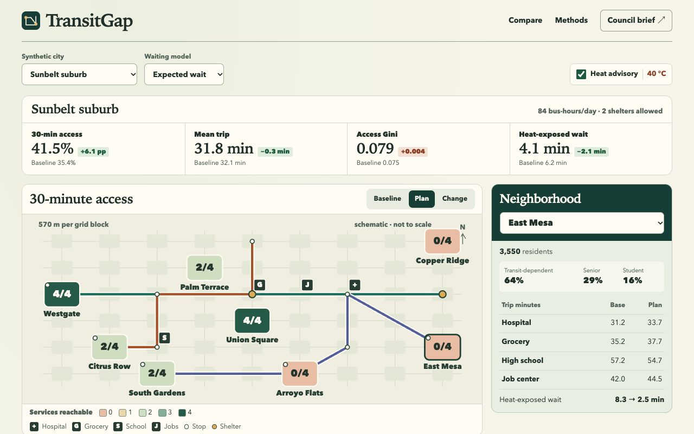
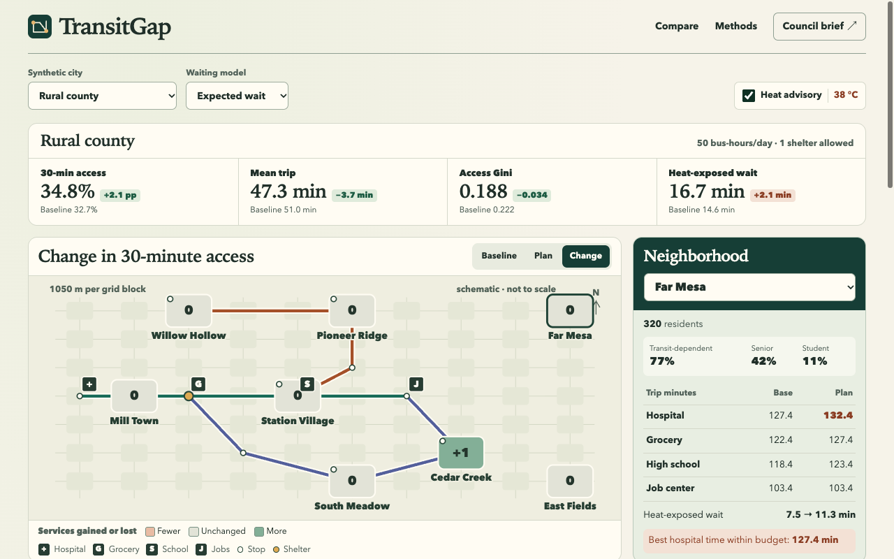

# TransitGap

TransitGap compares a peak-corridor baseline with an exact allocation of bus frequency and stop shelters. It is a static browser workbench using fictional cities. It does not predict effects in a real city.

## Run

```sh
npm start
nice -n 15 npm test
npm run benchmark
npm run test:browser
```

Use Node.js 22 or newer. The local server prints the URL and serves `/transitgap/`. The browser check uses headless Chrome with a temporary profile; set `CHROME_PATH` when Chrome is installed in a different location. No install step or npm dependencies are needed.

On a public host, serve this directory over HTTPS with the `/transitgap/` prefix and a trailing slash on the entry URL. The service worker precaches only the same-origin application shell. Change its cache version in `sw.js` whenever a cached resource changes. The HTML enforces a CSP from a meta tag; when supported, also send the CSP header from `test/serve.mjs` including `frame-ancestors 'none'`, which cannot be set by a meta tag.

## Compare two plans

- Choose the Sunbelt suburb, a midsize rail-and-feeder city, or a rural county. Switch between expected and timetable waiting; the latter takes a local departure clock time.
- Switch the map between baseline, plan and change. Click or keyboard-activate a neighborhood, or select it from the dropdown. The map color is backed by a numeric count of reachable services.
- Exchange buses between routes or move shelters without breaking the caps. Restore the optimizer to undo manual changes. Rail frequency is not part of the transit agency's synthetic bus budget.
- Download GeoJSON, equity CSV or an audit JSON. Import a bundle to verify its digest and replay its results. The English and Spanish council briefs print independently of the workbench controls.

## Model

Each contiguous grid is a bidirectional street graph with one residential origin per neighborhood. Destinations are one hospital, grocery store, high school and job center. Neighbors are one block away. Directed route states separate boarding, remaining onboard and alighting, so transfers incur a new wait and through trips do not. The Dijkstra solver minimizes modeled door-to-door earliest arrival. Expected wait is half a headway for each boarding, an assumption of random arrivals rather than a measured transfer delay. The exact mode uses the next departure at each stop in a repeating FIFO timetable.

Walking is 1.25 m/s below 35 C. At 35 C or above, let `e = min(T - 32, 18)`. Speed is `1.25 * (1 - 0.0175 * e)`, with travel time then multiplied by `1 + 0.035 * e * sun` and rounded up to whole seconds. Each street's sun fraction is deterministic and ranges from 0.3 through 0.9. The heat parameters and 80% exposure reduction at shelters are sensitivity assumptions, not medical or engineering estimates. Shelter placement affects exposed waiting, not trip duration.

`Headway = cycle minutes / vehicles`. Each route has a full round trip cycle including terminal slack. Integer fleet allocations are charged `buses * planned service hours per day`; the fixed rail line is excluded. Modeled trips assume service continues throughout the trip. The app does not model first and last trips, fares, capacity, reliability, emissions, disability-specific navigation or real city geography.

Mean trip time weights each resident equally and each destination equally. Thirty-minute coverage is the population-weighted share of all resident and service pairs reached in 30 minutes or less. A neighborhood's continuous access score is `1 / (1 + mean trip minutes / 30)`. The weighted Gini is the weighted sum of pairwise absolute score gaps divided by total population times total population-weighted access, counting each unordered pair once. Transit dependence, senior share and student share are descriptive, not extra weights.

The combined objective is `mean minutes + 25 * access Gini + 0.45 * heat-exposed wait minutes`. The optimizer enumerates every feasible fleet vector. For each vector, deterministic fastest paths are selected independently of shade. The exposure reductions for shelter stops therefore add up independently, so ranking stops by population-weighted exposure and taking the highest savings is exact. The score can improve while an individual metric worsens. Equal objective values keep the first enumerated fleet. The separate hospital minimum for each neighborhood is the best time across all feasible fleets; those minima need not be simultaneously achievable.

## Reproducibility

The benchmark below uses the heat advisory and expected waiting in each synthetic city. `npm run benchmark` regenerates these values from the model.

| Scenario | Buses charged in hours per day | Shelters | 30-minute coverage | Mean trip in minutes | Access Gini | Exposed waiting in minutes |
| --- | ---: | ---: | ---: | ---: | ---: | ---: |
| Sunbelt suburb | 84 | 2 | 35.4% to 41.5% | 32.11 to 31.76 | 0.0749 to 0.0794 | 6.23 to 4.12 |
| Rail and feeders | 52 | 3 | 42.4% to 54.3% | 29.97 to 27.58 | 0.0929 to 0.0760 | 4.93 to 4.80 |
| Rural county | 50 | 1 | 32.7% to 34.8% | 51.04 to 47.28 | 0.2219 to 0.1882 | 14.58 to 16.71 |

In the rural county six neighborhoods are over 45 minutes from the hospital under every feasible allocation. Far Mesa's independent minimum is 127.4 minutes; the selected plan takes 132.4 minutes from there. Better county-wide access does not eliminate that gap.

Audit JSON embeds the synthetic city, settings, allocation, outputs and SHA-256 over canonical UTF-8 payload bytes. The verifier checks the digest, requires a known scenario definition, recomputes the results and compares the canonical payload. The digest is not a signature. GeoJSON emits counterclockwise polygons in a fictitious Pacific coordinate frame with a `synthetic` flag. CSV quotes every cell and neutralizes formula-like text.

## Screens




