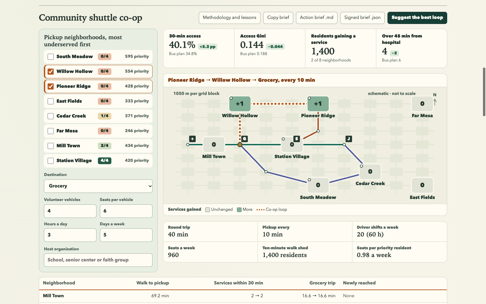

# TransitGap

TransitGap compares a peak-corridor baseline with an exact allocation of bus frequency and stop shelters. It is a static browser workbench using fictional cities. It does not predict effects in a real city.

**Live demo:** [https://aariv.me/transitgap/](https://aariv.me/transitgap/)

## Run

```sh
npm start
nice -n 15 npm test
npm run benchmark
npm run test:browser
```

Use Node.js 22 or newer. The local server prints the URL and serves `/transitgap/`. The browser check uses headless Chrome with a temporary profile; set `CHROME_PATH` when Chrome is installed in a different location. No install step or npm dependencies are needed.

On a public host, serve this directory over HTTPS with the `/transitgap/` prefix and a trailing slash on the entry URL. The service worker precaches only the same-origin application shell. Change its cache version in `sw.js` whenever a cached resource changes. The HTML enforces a CSP from a meta tag; when supported, also send the CSP header from `test/serve.mjs` including `frame-ancestors 'none'`, which cannot be set by a meta tag.

## Compare two plans

- Choose the Sunbelt suburb, a midsize rail-and-feeder city, or a rural county. Switch between expected and timetable waiting; the latter takes a local departure clock time.
- Switch the map between baseline, plan and change. Click or keyboard-activate a neighborhood, or select it from the dropdown. The map color is backed by a numeric count of reachable services.
- Exchange buses between routes or move shelters without breaking the caps. Restore the optimizer to undo manual changes. Rail frequency is not part of the transit agency's synthetic bus budget.
- Download GeoJSON, equity CSV or an audit JSON. Import a bundle to verify its digest and replay its results. The English and Spanish council briefs print independently of the workbench controls.

## Policy intervention lab

- Six deterministic scenarios sit below the workbench: baseline today, a dedicated bus rapid lane, peak headway halving, a late-night service floor, a feeder micro-shuttle and a cross-town express link, plus a slider-driven custom package (headway multiplier, speed gain, fare subsidy, added-service cap).
- The comparator reports population-weighted access delta, access Gini, Atkinson index (inequality aversion 0.5), top-bottom 20:20 and Palma ratios, dependent coverage, jobs inside 30 and 45 minutes, annual package cost and equity lift per `$1M` of annual cost. All costs are planning-model unit rates, not real-agency figures.
- Paired maps and reach-time bands (15, 30, 45 and 60 minutes) contrast the baseline network with the selected scenario for the inspector's neighborhood. The leverage table ranks single-corridor upgrades by equity gain per dollar.
- The address-bar hash (`#scenario=...`) bookmarks a preset or slider package for a deterministic reload. One-click exports produce a comparator CSV, a Markdown brief and a signed JSON impact bundle whose SHA-256 digest covers the canonical inputs and outputs; the in-page verifier replays the model and flags edits. Hashing uses a pure-JavaScript SHA-256 implementation, so verification works without Web Crypto.
- The "Verify math" button runs the in-page self-test suite: weighted-Gini bounds, population-weight conservation, intervention dominance invariants, SHA-256 known-answer vectors, URL hash round-trips, CSV injection escaping and digest tamper detection, with a live pass/fail badge.

## Community shuttle co-op

Residents, schools and senior centers in a transit desert can plan a volunteer carpool or shuttle loop that feeds the bus network.

- Pickup neighborhoods are listed most underserved first: services still beyond 30 minutes on the bus plan, times residents who are transit-dependent or senior. Tick up to three, or click a neighborhood on the co-op map, and choose the destination (hospital, grocery, high school or job center), vehicles, seats, hours a day and days a week.
- The loop is added as one more two-way line in the same street and transit graph, so walking to a pickup, waiting, riding and transferring to a bus all come out of the existing Dijkstra search. A leg takes `ceil(blocks * block meters / 450) + 1` minutes, the round trip is `2 * legs + 8` minutes of turnaround, headway is `round trip / vehicles` and the wait is half the headway.
- "Suggest the best loop" tries every destination with every single pickup and every pair (144 loops per city) and keeps the one that adds the most service pairs within 30 minutes for transit-dependent and senior residents, with a large bonus for each neighborhood brought back within 45 minutes of the hospital.
- The planner reports 30-minute access, access Gini, residents gaining a service, neighborhoods over 45 minutes from the hospital, the ten-minute walk shed around pickups, driver shifts, weekly seats and seats per priority resident.
- The Community Action Brief copies to the clipboard or downloads as Markdown (route, modeled gains, per-neighborhood table, volunteer plan and a safety checklist) or as JSON with a SHA-256 digest over the payload. The host organization name is stripped of markup before it reaches the brief.
- "Methodology and lessons" opens a drawer with the equations, the search rule, lessons from the build and the model's limits.

Suggested loops with the default two vehicles, six seats, three hours a day (heat advisory, expected waiting, optimized bus plan):

| City | Loop | Round trip | 30-minute coverage | Access Gini | Over 45 min from hospital |
| --- | --- | ---: | ---: | ---: | ---: |
| Sunbelt suburb | Citrus Row to Arroyo Flats to Job center | 34 min | 41.5% to 63.1% | 0.0794 to 0.0733 | 0 to 0 |
| Rail and feeders | Orchard to North Loop to Job center | 28 min | 54.3% to 69.0% | 0.0760 to 0.0813 | 0 to 0 |
| Rural county | Pioneer Ridge to Willow Hollow to Hospital | 50 min | 34.8% to 37.7% | 0.1882 to 0.1587 | 6 to 4 |

In the rail city the loop raises coverage while the access Gini worsens; the planner shows both. All gains are modeled on synthetic cities and hold only inside the service window. Fares, booking, detours, boarding time for wheelchairs and driver availability are not modeled.

## Model

Each contiguous grid is a bidirectional street graph with one residential origin per neighborhood. Destinations are one hospital, grocery store, high school and job center. Neighbors are one block away. Directed route states separate boarding, remaining onboard and alighting, so transfers incur a new wait and through trips do not. The Dijkstra solver minimizes modeled door-to-door earliest arrival. Expected wait is half a headway for each boarding, an assumption of random arrivals rather than a measured transfer delay. The exact mode uses the next departure at each stop in a repeating FIFO timetable.

Walking is 1.25 m/s below 35 C. At 35 C or above, let `e = min(T - 32, 18)`. Speed is `1.25 * (1 - 0.0175 * e)`, with travel time then multiplied by `1 + 0.035 * e * sun` and rounded up to whole seconds. Each street's sun fraction is deterministic and ranges from 0.3 through 0.9. The heat parameters and 80% exposure reduction at shelters are sensitivity assumptions, not medical or engineering estimates. Shelter placement affects exposed waiting, not trip duration. Shelters may be placed at stops on lines whose fleets can change.

`Headway = cycle minutes / vehicles`. Each route has a full round trip cycle including terminal slack. Integer fleet allocations are charged `buses * planned service hours per day`; the fixed rail line is excluded. Modeled trips assume service continues throughout the trip. The app does not model first and last trips, fares, capacity, reliability, emissions, disability-specific navigation or real city geography.

Mean trip time weights each resident equally and each destination equally. Thirty-minute coverage is the population-weighted share of all resident and service pairs reached in 30 minutes or less. A neighborhood's continuous access score is `1 / (1 + mean trip minutes / 30)`. The weighted Gini is the weighted sum of pairwise absolute score gaps divided by total population times total population-weighted access, counting each unordered pair once. Transit dependence, senior share and student share are descriptive, not extra weights.

The combined objective is `mean minutes + 25 * access Gini + 0.45 * heat-exposed wait minutes`. The optimizer enumerates every feasible fleet vector. For each vector, deterministic fastest paths are selected independently of shade. The exposure reductions for shelter stops therefore add up independently, so ranking stops by population-weighted exposure and taking the highest savings is exact. The score can improve while an individual metric worsens. Equal objective values keep the first enumerated fleet. The separate hospital minimum for each neighborhood is the best time across all feasible fleets; those minima need not be simultaneously achievable.

## Reproducibility

The benchmark below uses the heat advisory and expected waiting in each synthetic city. `npm run benchmark` regenerates these values from the model.

| Scenario | Buses charged in hours per day | Shelters | 30-minute coverage | Mean trip in minutes | Access Gini | Exposed waiting in minutes |
| --- | ---: | ---: | ---: | ---: | ---: | ---: |
| Sunbelt suburb | 84 | 2 | 35.4% to 41.5% | 32.11 to 31.76 | 0.0749 to 0.0794 | 6.23 to 4.12 |
| Rail and feeders | 52 | 3 | 42.4% to 54.3% | 29.97 to 27.58 | 0.0929 to 0.0760 | 4.93 to 4.80 |
| Rural county | 50 | 1 | 32.7% to 34.8% | 51.04 to 47.28 | 0.2219 to 0.1882 | 14.58 to 16.71 |

In the rural county six neighborhoods are over 45 minutes from the hospital under every feasible allocation. Far Mesa's independent minimum is 127.4 minutes; the selected plan takes 132.4 minutes from there. Better county-wide access does not eliminate that gap.

Audit JSON embeds the synthetic city, settings, allocation, outputs and SHA-256 over canonical UTF-8 payload bytes. The verifier checks the digest, requires a known scenario definition, recomputes the results and compares the canonical payload. The digest is not a signature. GeoJSON emits counterclockwise polygons in a fictitious Pacific coordinate frame with a `synthetic` flag. CSV quotes every cell and neutralizes formula-like text.

The policy impact bundle signs the same way: a canonical payload of city, options, scenario selection, every evaluated intervention, the leverage ranking and unit costs, hashed with the pure-JavaScript SHA-256 in `src/sha256.js`. `verifyPolicyJson` rechecks the digest and deterministically replays every scenario before accepting a file.

## Screens



